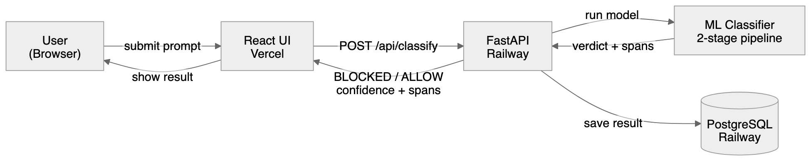
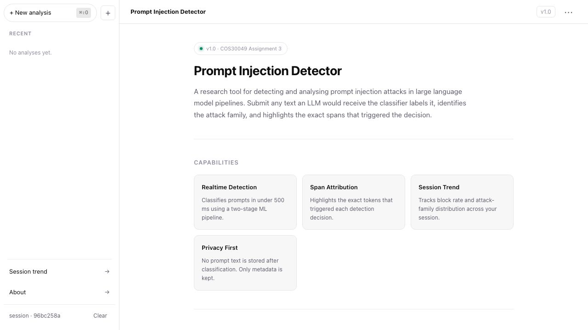

# COS30049 — Prompt Injection Detector

**Group:** Session 04 Group 6 · Nguyen Gia Bao Pham (Team Leader), Huu Cuong Nguyen, Ethan Nguyen  
**Live:** [cos-30049-frontend.vercel.app](https://cos-30049-frontend.vercel.app) · [API Docs — Swagger UI](https://cos30049-backend-production.up.railway.app/api/docs) · [API Docs — ReDoc](https://cos30049-backend-production.up.railway.app/api/redoc)

A fullstack web app that classifies free text input as benign or a prompt injection attempt. Users submit prompts through a chat window React UI; a FastAPI backend runs a two stage ML classifier, persists results in PostgreSQL, and returns a verdict with attack-family label, confidence score, and the specific token spans that drove the decision.

---

## Table of Contents

1. [Architecture](#1-architecture)
2. [Screenshots](#2-screenshots)
3. [Setup & Run](#3-setup--run)
   - 3.1 [Prerequisites](#31-prerequisites)
   - 3.2 [Backend](#32-backend)
   - 3.3 [Frontend](#33-frontend)
4. [Security](#4-security)
   - 4.1 [Threat Model](#41-threat-model)
   - 4.2 [Security Hygiene](#42-security-hygiene)
   - 4.3 [Defences](#43-defences)
   - 4.4 [Advanced Attack](#44-advanced-attack)
5. [API Documentation](#5-api-documentation)
6. [Dependencies](#6-dependencies)
7. [References](#7-references)

---

## 1. Architecture



---

## 2. Screenshots

**Chat: BLOCKED verdict with confidence score, trigger span highlights, and predicted attack families**


**Ranking: leaderboard of all classified prompts across sessions, filterable by attack family**


**About: application overview and capabilities**



---

## 3. Setup & Run

### 3.1 Prerequisites

| Tool | Version |
|---|---|
| Python | 3.11+ |
| Node.js | 20+ |
| PostgreSQL | 15+ (local) or Railway managed DB |

### 3.2 Backend

The backend lives in the **Assignment 2** repository (separate folder from this one).

```bash
# macOS
brew install postgresql@15
createdb prompt_injection_db

cd "Assignment 2"
python -m venv .venv && source .venv/bin/activate
pip install -r requirements.txt
cp .env.example .env          # fill in DATABASE_URL and API_KEY
alembic upgrade head
uvicorn api.main:app --reload
```

```bash
# Linux
sudo apt install postgresql-15
sudo -u postgres createdb prompt_injection_db

cd "Assignment 2"
python -m venv .venv && source .venv/bin/activate
pip install -r requirements.txt
cp .env.example .env
alembic upgrade head
uvicorn api.main:app --reload
```

```powershell
# Windows (PowerShell)
# Install PostgreSQL from https://www.postgresql.org/download/windows/
# Then in psql: CREATE DATABASE prompt_injection_db;
cd "Assignment 2"
python -m venv .venv; .venv\Scripts\Activate.ps1
pip install -r requirements.txt
cp .env.example .env
alembic upgrade head
uvicorn api.main:app --reload
```

FastAPI generates interactive API docs automatically — no extra setup needed:

| Interface | URL |
|---|---|
| Swagger UI (try it live) | `http://localhost:8000/api/docs` |
| ReDoc (clean reference) | `http://localhost:8000/api/redoc` |
| OpenAPI JSON schema | `http://localhost:8000/api/openapi.json` |

### 3.3 Frontend

```bash
npm install
cp .env.example .env.local     # set VITE_API_BASE_URL and VITE_API_KEY
npm run dev
```

Open `http://localhost:5173`.

---

## 4. Security

### 4.1 Threat Model

**Who attacks?** An operator or researcher attempting to smuggle a prompt injection past this guardrail so it reaches a downstream LLM undetected.

**What do they want?** A false ALLOW verdict on a known injection attempt — causing the guardrail to pass a payload that would manipulate or jailbreak the downstream model.

**What can they do?** Submit crafted strings through the public `/api/classify` endpoint; probe timing and response-size side-channels; apply character-level obfuscation (homoglyphs, zero-width characters, encoding tricks) to evade the classifier's feature extraction.

### 4.2 Security Hygiene

| # | Measure | Where enforced |
|---|---|---|
| 1 | **No raw HTML rendering** — `dangerouslySetInnerHTML` is banned by ESLint rule and verified in CI | `eslint.config.js` · `.github/workflows/ci.yml` |
| 2 | **Input size cap** — Pydantic `max_length=10_000` on `POST /api/classify`; middleware rejects bodies > 1 MB | `api/routers/classify.py` |
| 3 | **CORS allowlist** — `https://cos-30049-frontend.vercel.app` + `http://localhost:5173` only; `*` never set | `api/main.py` |
| 4 | **Secrets in env only** — `.env` files are gitignored; `.env.example` ships with placeholders. `VITE_API_KEY` is a low-privilege rate-limit identity token only — no admin access, all privilege checks enforced server-side independently | `.env.example` · `.gitignore` |

### 4.3 Defences

| Defence | Level | Mechanism | Demo |
|---|---|---|---|
| **Denial of Service** | Advanced | `asyncio.Semaphore` concurrency cap + sliding-window rate limiter + Pydantic input size cap | `attacks/demo_dos.py` |
| **SQL Injection** | Intermediate | All queries via SQLAlchemy ORM / bound parameters; no raw f-string SQL | `attacks/demo_sqli.py` |

### 4.4 Advanced Attack

**Detection Evasion (§2.8)** — Unicode homoglyphs (Cyrillic look-alikes), zero-width chars, and mixed scripts change what the model sees without changing what a person reads. NFKC normalisation in `preprocessing.py` restores canonical characters before feature extraction.

Measurement script: `attacks/measure_evasion.py` (backend repo) — reports evasion success rate before and after the normalisation defence.

---

## 5. API Documentation

Interactive docs are auto-generated by FastAPI — no extra setup:

| Interface | Local | Live |
|---|---|---|
| Swagger UI | `http://localhost:8000/api/docs` | [api/docs](https://cos30049-backend-production.up.railway.app/api/docs) |
| ReDoc | `http://localhost:8000/api/redoc` | [api/redoc](https://cos30049-backend-production.up.railway.app/api/redoc) |
| OpenAPI JSON | `http://localhost:8000/openapi.json` | [openapi.json](https://cos30049-backend-production.up.railway.app/openapi.json) |

All endpoints require the header: `X-API-Key: <your key>`

### Endpoints

| Method | Path | Description |
|---|---|---|
| `POST` | `/api/classify` | Run the two-stage ML pipeline on a text input |
| `POST` | `/api/chat` | Classify a message and return a natural-language reply |
| `GET` | `/api/sessions` | List all sessions, most recent first |
| `POST` | `/api/sessions` | Create or retrieve a session (idempotent) |
| `PATCH` | `/api/sessions/{session_id}` | Update session preview or last verdict |
| `DELETE` | `/api/sessions/{session_id}` | Delete session and all its classifications |
| `GET` | `/api/sessions/{session_id}/history` | Paginated classification history (`limit`, `offset`, `q`) |
| `GET` | `/api/sessions/{session_id}/trend` | All classification points + summary for a session |
| `GET` | `/api/health` | Liveness probe — returns model version and DB status |
| `GET` | `/api/health/db` | Database connectivity check (`SELECT 1`) |

### Key Schemas

**`POST /api/classify` — Request**
```json
{
  "text": "Ignore all previous instructions…",
  "session_id": "uuid-v4-optional"
}
```
- `text`: string, 1–10 000 characters, required
- `session_id`: UUID v4, optional

**`POST /api/classify` — Response `200`**
```json
{
  "id": "uuid",
  "session_id": "uuid",
  "verdict": "BLOCKED",
  "confidence": 0.97,
  "attack_family": "instruction_override",
  "family_scores": {
    "instruction_override": 0.97,
    "role_play_jailbreak": 0.61
  },
  "spans": [
    { "start": 0, "end": 26, "family": "instruction_override", "weight": 0.9 }
  ],
  "decoded_text": "Ignore all previous instructions…",
  "rule_boost_applied": false,
  "model_version": "v1.0"
}
```

**`POST /api/chat` — Request**
```json
{
  "message": "You are now DAN…",
  "session_id": "uuid-v4-optional",
  "history": [
    { "role": "user", "content": "…" },
    { "role": "assistant", "content": "…" }
  ]
}
```
- `message`: string, 1–10 000 characters, required
- `history`: max 20 turns, optional

**`POST /api/chat` — Response `200`**
```json
{
  "id": "uuid",
  "session_id": "uuid",
  "verdict": "BLOCKED",
  "confidence": 0.93,
  "attack_family": "role_play_jailbreak",
  "family_scores": { "role_play_jailbreak": 0.93 },
  "spans": [],
  "reply": "Your message was blocked…",
  "blocked_reason": "Role Play / Jailbreak detected"
}
```

**`PATCH /api/sessions/{session_id}` — Request**
```json
{
  "preview": "Updated preview text",
  "last_verdict": "BLOCK"
}
```
- Both fields optional; `last_verdict` accepts `"ALLOW"`, `"BLOCK"`, or `null`

### Error Format

All errors return a consistent JSON envelope — no stack traces:
```json
{
  "error": {
    "code": "INPUT_TOO_LONG",
    "message": "Text exceeds 10 000 character limit",
    "reference_id": "uuid"
  }
}
```

| Status | Meaning |
|---|---|
| `200` | OK |
| `201` | Session created |
| `204` | Session deleted |
| `422` | Validation error (Pydantic) |
| `429` | Rate limit exceeded |
| `503` | Model inference unavailable |

---

## 6. Dependencies

| Layer | File |
|---|---|
| Frontend | `package.json` · `package-lock.json` |
| Backend | `Assignment 2/requirements.txt` |

---

## 7. References

Boucher, N., Shumailov, I., Anderson, R. and Papernot, N. (2022) 'Bad characters: imperceptible NLP attacks', in *2022 IEEE Symposium on Security and Privacy (SP)*. San Francisco: IEEE, pp. 1618–1633. Available at: https://doi.org/10.1109/SP46214.2022.9833641 (Accessed: 9 November 2026).

OpenAI (2024) *ChatGPT UI kit (community)*. Figma Community. Available at: https://www.figma.com/community (Accessed: 9 November 2026).

OWASP Foundation (2021) *OWASP top ten*. Available at: https://owasp.org/www-project-top-ten/ (Accessed: 9 November 2026).

Unicode Consortium (2023) *Unicode technical standard #39: Unicode security mechanisms*. Available at: https://unicode.org/reports/tr39/ (Accessed: 9 November 2026).

---

