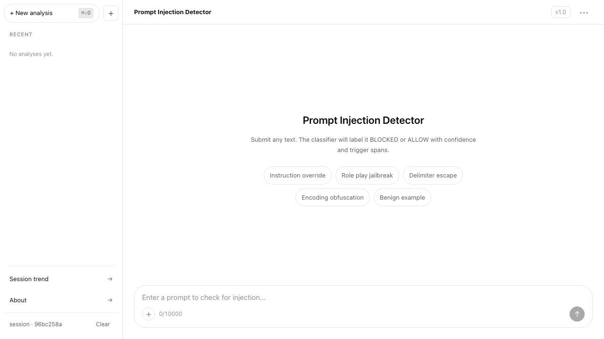
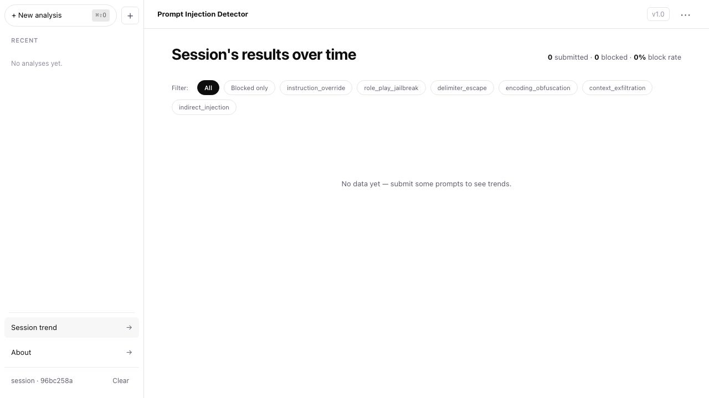
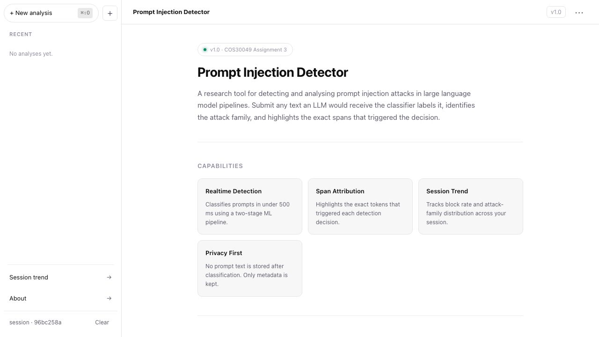

# Prompt Injection Detector — Frontend

A React 19 + TypeScript + Vite single-page application for the **COS30049 Assignment 3** project. It provides a chat-style interface for submitting text (or attached files) to a FastAPI ML backend, then renders a verdict, confidence meter, highlighted trigger spans, and per-family attack scores. A trend page tracks block-rate and attack-family distribution across the session.

---

## Screenshots

### Chat interface — empty state



The left sidebar lists recent sessions. Example chips let you try built-in prompts without typing. The `+` button attaches a file (PDF, .md, .docx, .csv, .xlsx); extracted text is prepended to the submit payload.

### Session trend



Tracks every classification result in the current session. Filter chips narrow the view to a single attack family or blocked-only results. The rank table shows blocked count and percentage of total for each of the six canonical attack families.

### About page



---

## Features

| Feature | Detail |
|---|---|
| **Prompt classification** | POST to `/api/classify` → BLOCKED / ALLOW verdict with confidence % |
| **Span highlighting** | Exact token spans that triggered the decision are highlighted inline |
| **Family breakdown** | Per-family score bars (instruction_override, role_play_jailbreak, delimiter_escape, encoding_obfuscation, context_exfiltration, indirect_injection) |
| **File attachment** | Attach PDF, Markdown, DOCX, CSV, or XLSX — text extracted client-side before submit |
| **Session trend** | Block-rate summary + attack-family rank table from `/api/sessions/:id/trend` |
| **Session history** | Last 50 results loaded on mount from `/api/sessions/:id/history` |
| **Multi-session sidebar** | Create, switch, and delete named sessions; metadata persisted in the backend DB |
| **Theme toggle** | Light / dark mode toggled from the topbar; persists in the app state |
| **Keyboard shortcuts** | `⌘K` focus composer · `⌘⇧O` new analysis · `J`/`K` scroll messages |

---

## Tech stack

| Layer | Technology |
|---|---|
| Framework | React 19.3 |
| Language | TypeScript 7 |
| Bundler | Vite 8 |
| Routing | React Router 7 |
| State | Zustand 5 |
| HTTP | Axios 1.x |
| Charts | Recharts 3 |
| PDF extraction | pdfjs-dist 6 |
| DOCX extraction | mammoth 1.x |
| XLSX extraction | SheetJS (xlsx) 0.18 |
| Linter | Oxlint + ESLint |

---

## Project structure

```
frontend/
├── src/
│   ├── api/
│   │   └── client.ts          # Axios instance + all API helpers
│   ├── components/
│   │   ├── chat/
│   │   │   ├── ChatComposer   # Textarea + file attach + submit
│   │   │   ├── ChatFeed       # Message list + empty state
│   │   │   └── AssistantResponse  # Verdict card per message
│   │   ├── layout/
│   │   │   ├── AppShell       # Sidebar + topbar wrapper
│   │   │   ├── Sidebar        # Session list + navigation links
│   │   │   └── Topbar         # Title + theme toggle + model badge
│   │   ├── trend/
│   │   │   ├── BlockRateSparkline
│   │   │   ├── FamilyFilterChips
│   │   │   ├── SessionTimeline
│   │   │   └── familyMeta.ts  # Display labels for attack families
│   │   ├── verdict/
│   │   │   ├── VerdictBadge   # BLOCKED / ALLOW chip + confidence meter
│   │   │   ├── FamilyBreakdown  # Per-family score bars
│   │   │   └── SpanHighlighter  # Annotated prompt text
│   │   └── ui/
│   │       └── Toast
│   ├── hooks/
│   │   └── useShortcuts.ts    # ⌘K / ⌘⇧O / J / K keyboard handlers
│   ├── pages/
│   │   ├── ChatPage           # Main analysis view
│   │   ├── TrendPage          # Session analytics
│   │   ├── HistoryPage        # Paginated past results
│   │   └── AboutPage          # Capability overview
│   ├── store/
│   │   └── sessionStore.ts    # Zustand store; syncs to backend API
│   ├── types/
│   │   └── api.ts             # Shared TypeScript types
│   ├── utils/
│   │   ├── normaliseFamily.ts # Maps backend alias names → canonical families
│   │   └── fileExtract.ts     # Client-side text extraction from files
│   └── styles/
│       ├── tokens.css         # Design tokens (colors, spacing, radii)
│       └── reset.css
├── public/
│   ├── favicon.svg
│   └── icons.svg
├── .env.example               # Required environment variables
├── vite.config.ts
└── package.json
```

---

## Getting started

### Prerequisites

- Node.js ≥ 20
- npm ≥ 9
- Backend API running (see [COS30049-Backend](https://github.com/baothanhthienn/COS30049-Backend))

### Install

```bash
cd frontend
npm install
```

### Configure environment

Copy the example file and fill in your values:

```bash
cp .env.example .env
```

```env
VITE_API_BASE_URL=http://localhost:8000   # FastAPI backend URL
VITE_API_KEY=your_api_key_here            # Sent as X-API-Key header on every request
VITE_MODEL_VERSION=v1.0                   # Displayed in the topbar model badge
```

> **Note:** `VITE_API_KEY` is optional. If omitted, no `X-API-Key` header is sent.

### Run locally

```bash
npm run dev
```

App opens at `http://localhost:5173` (Vite picks the next free port if 5173 is taken).

### Build for production

```bash
npm run build
```

Output is in `dist/`. Deploy to Vercel, Netlify, or any static host.

```bash
npm run preview   # preview the production build locally
```

---

## API integration

All requests go through `src/api/client.ts`. The base URL and optional API key come from environment variables.

| Function | Method | Endpoint | Purpose |
|---|---|---|---|
| `classify(text, sessionId)` | POST | `/api/classify` | Submit a prompt for classification |
| `fetchTrend(sessionId)` | GET | `/api/sessions/:id/trend` | Load session analytics |
| `fetchHistory(sessionId)` | GET | `/api/sessions/:id/history` | Load past 50 classifications |
| `listSessions()` | GET | `/api/sessions` | Fetch all sessions for sidebar |
| `upsertSession(id, preview)` | POST | `/api/sessions` | Create / update a session record |
| `patchSession(id, patch)` | PATCH | `/api/sessions/:id` | Update verdict / preview on a session |
| `deleteSession(id)` | DELETE | `/api/sessions/:id` | Remove a session and its history |
| `getHealth()` | GET | `/api/health` | Backend health check |

Error responses are wrapped in `ApiError` (class in `client.ts`) with `status`, `code`, and `referenceId` fields. The chat page renders a user-friendly error message for status 0 (unreachable), 502, and 503.

---

## Attack families

The classifier returns one of six canonical attack family names. The `normaliseFamily` utility maps backend aliases to the canonical set so the frontend never breaks on alias variants.

| Canonical name | Description |
|---|---|
| `instruction_override` | Attempts to replace or ignore the system prompt |
| `role_play_jailbreak` | Uses fictional personas to bypass restrictions |
| `delimiter_escape` | Injects control characters or delimiters to break prompt structure |
| `encoding_obfuscation` | Encodes malicious content to evade text-based filters |
| `context_exfiltration` | Tries to extract system context, instructions, or prior turns |
| `indirect_injection` | Embeds instructions in external content (documents, URLs) |

---

## File attachment

The `+` button in the composer opens a file picker. Supported formats and extraction method:

| Format | Extension | Extraction |
|---|---|---|
| PDF | `.pdf` | `pdfjs-dist` — text layer extracted page-by-page |
| Markdown / plain text | `.md`, `.txt` | `FileReader.readAsText` |
| CSV | `.csv` | `FileReader.readAsText` |
| Excel | `.xlsx` | SheetJS `sheet_to_csv` per sheet, joined with newlines |
| Word | `.docx` | `mammoth.extractRawText` |

Extracted text is prepended to the textarea content and sent as a single string to `/api/classify`. No file is uploaded to the server.

---

## Keyboard shortcuts

| Shortcut | Action |
|---|---|
| `⌘K` / `Ctrl+K` | Focus the prompt composer |
| `⌘⇧O` / `Ctrl⇧O` | Start a new analysis (clears messages, new session ID) |
| `J` | Scroll to next message (when not typing) |
| `K` | Scroll to previous message (when not typing) |

---

## Scripts

```bash
npm run dev       # start Vite dev server with HMR
npm run build     # type-check then bundle for production
npm run preview   # serve the production build locally
npm run lint      # run Oxlint on all source files
```

---

## Development notes

- **Family name normalisation** — `src/utils/normaliseFamily.ts` maps legacy backend aliases (e.g. `encoding_evasion → encoding_obfuscation`) at every ingestion point: classify result in `ChatPage`, history load in `sessionStore`, and trend API response in `TrendPage`.
- **Session storage** — The active session ID is kept in `sessionStorage` (tab-scoped). Session metadata is synced to the backend via REST so it survives page refresh.
- **CSS architecture** — Global design tokens in `src/styles/tokens.css`. Each component has a co-located `.css` file. `data-theme="dark"` on `<html>` switches the token set.
- **No server-side rendering** — Pure SPA. The `dist/` directory is a static bundle with client-side routing via React Router.
